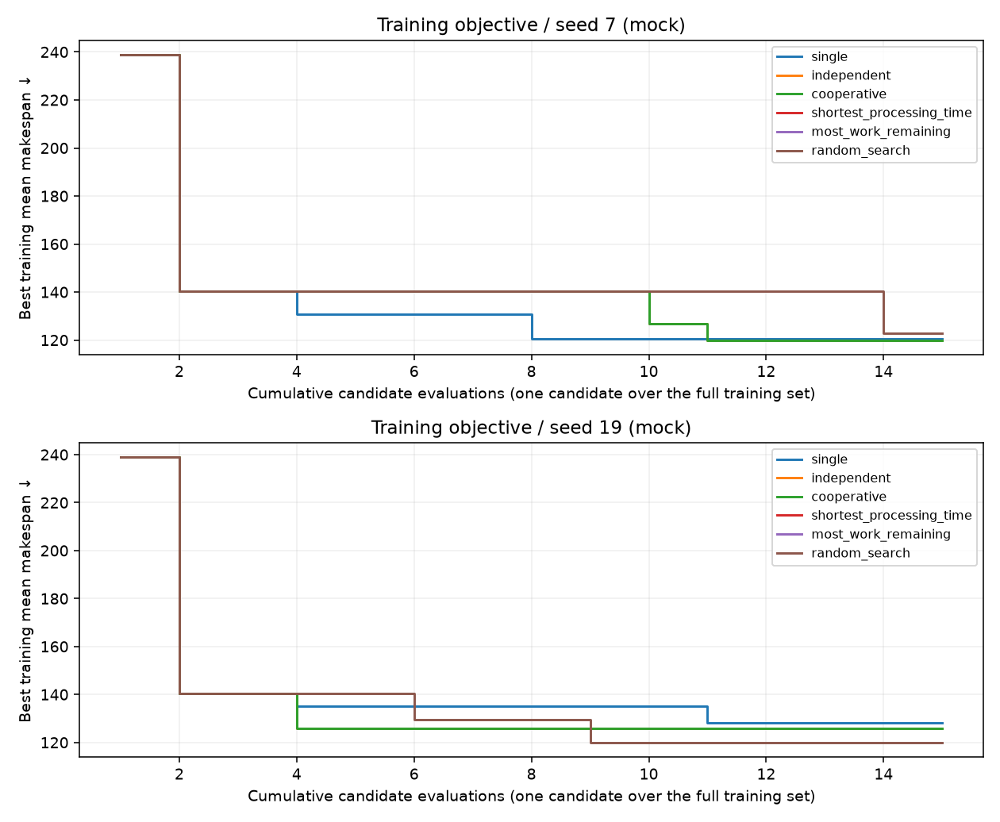
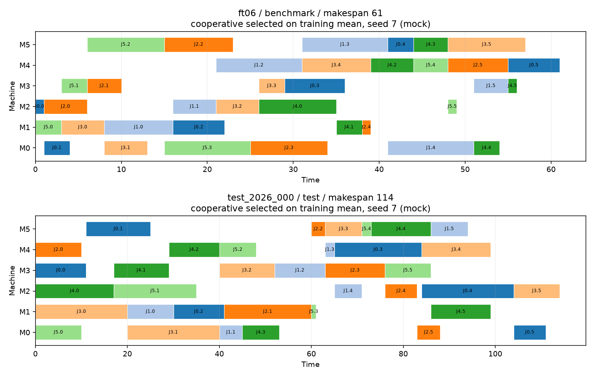

# Swarm scheduling experiment report

> **MOCK / OFFLINE FUNCTIONAL DEMONSTRATION. No real model was called; these results are not empirical evidence about LLM swarm performance.**

This experiment searches restricted JSON dispatching rules. Lower mean training makespan is better. The held-out test set is evaluated only after policy selection; it never supplies agent feedback, migrations, or policy selection.

A candidate evaluation means running one policy across every training instance. Initial candidates consume this budget. Methods share the same initial candidates. Model call failures and retries consume the call budget. Baselines make no model calls.

## Run configuration

```json
{
  "api_key_env": "SWARM_API_KEY",
  "backend": "mock",
  "base_url": null,
  "data_seed": 2026,
  "duration_max": 20,
  "jobs": 6,
  "machines": 6,
  "max_calls": 12,
  "max_evaluations": 15,
  "max_output_tokens": 512,
  "max_retries": 0,
  "max_tokens": 24000,
  "methods": [
    "single",
    "independent",
    "cooperative",
    "shortest_processing_time",
    "most_work_remaining",
    "random_search"
  ],
  "model": null,
  "seeds": [
    7,
    19
  ],
  "solver_time_limit": 2.0,
  "test_count": 8,
  "timeout": 60.0,
  "train_count": 8,
  "workers": 1
}
```

## Final selected-policy measurements

Training, held-out generated instances, and public FT06 are separate below. `best` is the smallest makespan among instances in that split, not a new cross-instance optimization target. Compare means only for the same data split and seed.

| Seed | Method | Split | Valid / total | Best | Mean | Worst |
| --- | --- | --- | --- | --- | --- | --- |
| 7 | single | train | 8 / 8 | 104 | 120.5 | 137 |
| 7 | single | test | 8 / 8 | 101 | 120 | 152 |
| 7 | single | benchmark | 1 / 1 | 60 | 60 | 60 |
| 7 | independent | train | 8 / 8 | 106 | 120 | 138 |
| 7 | independent | test | 8 / 8 | 102 | 120.25 | 162 |
| 7 | independent | benchmark | 1 / 1 | 61 | 61 | 61 |
| 7 | cooperative | train | 8 / 8 | 106 | 120 | 138 |
| 7 | cooperative | test | 8 / 8 | 102 | 120.25 | 162 |
| 7 | cooperative | benchmark | 1 / 1 | 61 | 61 | 61 |
| 7 | shortest_processing_time | train | 8 / 8 | 207 | 238.875 | 296 |
| 7 | shortest_processing_time | test | 8 / 8 | 177 | 221.5 | 245 |
| 7 | shortest_processing_time | benchmark | 1 / 1 | 109 | 109 | 109 |
| 7 | most_work_remaining | train | 8 / 8 | 119 | 140.5 | 163 |
| 7 | most_work_remaining | test | 8 / 8 | 117 | 135.75 | 172 |
| 7 | most_work_remaining | benchmark | 1 / 1 | 74 | 74 | 74 |
| 7 | random_search | train | 8 / 8 | 108 | 122.75 | 144 |
| 7 | random_search | test | 8 / 8 | 104 | 117.875 | 140 |
| 7 | random_search | benchmark | 1 / 1 | 61 | 61 | 61 |
| 19 | single | train | 8 / 8 | 102 | 128.125 | 154 |
| 19 | single | test | 8 / 8 | 108 | 123.25 | 152 |
| 19 | single | benchmark | 1 / 1 | 69 | 69 | 69 |
| 19 | independent | train | 8 / 8 | 109 | 126 | 163 |
| 19 | independent | test | 8 / 8 | 103 | 122.875 | 172 |
| 19 | independent | benchmark | 1 / 1 | 58 | 58 | 58 |
| 19 | cooperative | train | 8 / 8 | 109 | 126 | 163 |
| 19 | cooperative | test | 8 / 8 | 103 | 122.875 | 172 |
| 19 | cooperative | benchmark | 1 / 1 | 58 | 58 | 58 |
| 19 | shortest_processing_time | train | 8 / 8 | 207 | 238.875 | 296 |
| 19 | shortest_processing_time | test | 8 / 8 | 177 | 221.5 | 245 |
| 19 | shortest_processing_time | benchmark | 1 / 1 | 109 | 109 | 109 |
| 19 | most_work_remaining | train | 8 / 8 | 119 | 140.5 | 163 |
| 19 | most_work_remaining | test | 8 / 8 | 117 | 135.75 | 172 |
| 19 | most_work_remaining | benchmark | 1 / 1 | 74 | 74 | 74 |
| 19 | random_search | train | 8 / 8 | 106 | 119.875 | 137 |
| 19 | random_search | test | 8 / 8 | 104 | 120.625 | 158 |
| 19 | random_search | benchmark | 1 / 1 | 61 | 61 | 61 |

## Actual search resources

Budgets apply separately to each method and seed; CPU and wall times vary by machine. Unknown token usage is not reported as zero. Token reservations are a conservative budget control, not measured provider consumption. Complete resource records are in `results.json` and `summary.csv` (repeated per split for convenience).

| Seed | Method | Calls | Failures | Candidate evaluations | Input tokens | Output tokens | Unknown-usage calls | Wall seconds | CPU seconds | Token accounting |
| --- | --- | --- | --- | --- | --- | --- | --- | --- | --- | --- |
| 7 | single | 12 | 0 | 15 | 3216 | 524 | 0 | 0.107 | 0.107 | estimated_mock |
| 7 | independent | 12 | 0 | 15 | 2894 | 540 | 0 | 0.099 | 0.099 | estimated_mock |
| 7 | cooperative | 12 | 0 | 15 | 2877 | 530 | 0 | 0.102 | 0.102 | estimated_mock |
| 7 | shortest_processing_time | 0 | 0 | 1 | 0 | 0 | 0 | 0.006 | 0.006 | not_used |
| 7 | most_work_remaining | 0 | 0 | 1 | 0 | 0 | 0 | 0.011 | 0.011 | not_used |
| 7 | random_search | 0 | 0 | 15 | 0 | 0 | 0 | 0.096 | 0.096 | not_used |
| 19 | single | 12 | 0 | 15 | 3215 | 522 | 0 | 0.102 | 0.102 | estimated_mock |
| 19 | independent | 12 | 0 | 15 | 2921 | 541 | 0 | 0.102 | 0.102 | estimated_mock |
| 19 | cooperative | 12 | 0 | 15 | 2911 | 537 | 0 | 0.099 | 0.099 | estimated_mock |
| 19 | shortest_processing_time | 0 | 0 | 1 | 0 | 0 | 0 | 0.007 | 0.007 | not_used |
| 19 | most_work_remaining | 0 | 0 | 1 | 0 | 0 | 0 | 0.007 | 0.007 | not_used |
| 19 | random_search | 0 | 0 | 15 | 0 | 0 | 0 | 0.126 | 0.126 | not_used |

## Search traces



Real-model token comparison: **not run** (mock backend). Mock token values are estimates for exercising budget accounting.

## Independent OR-Tools references

An incumbent objective is an upper bound on the minimum makespan. A valid best bound is a lower bound, not the true optimum. `FEASIBLE`, `UNKNOWN`, or a timeout does not prove optimality. Each reference records its solver status and time limit in raw results.

| Seed | Split | Instance | Status | Incumbent upper bound | Valid lower bound | Proven optimal | Solver wall seconds |
| --- | --- | --- | --- | --- | --- | --- | --- |
| 7 | train | train_2026_000 | OPTIMAL | 94 | 94 | true | 0.006 |
| 7 | train | train_2026_001 | OPTIMAL | 98 | 98 | true | 0.005 |
| 7 | train | train_2026_002 | OPTIMAL | 114 | 114 | true | 0.004 |
| 7 | train | train_2026_003 | OPTIMAL | 99 | 99 | true | 0.005 |
| 7 | train | train_2026_004 | OPTIMAL | 108 | 108 | true | 0.006 |
| 7 | train | train_2026_005 | OPTIMAL | 116 | 116 | true | 0.004 |
| 7 | train | train_2026_006 | OPTIMAL | 109 | 109 | true | 0.005 |
| 7 | train | train_2026_007 | OPTIMAL | 109 | 109 | true | 0.007 |
| 7 | test | test_2026_000 | OPTIMAL | 98 | 98 | true | 0.01 |
| 7 | test | test_2026_001 | OPTIMAL | 95 | 95 | true | 0.01 |
| 7 | test | test_2026_002 | OPTIMAL | 95 | 95 | true | 0.004 |
| 7 | test | test_2026_003 | OPTIMAL | 103 | 103 | true | 0.008 |
| 7 | test | test_2026_004 | OPTIMAL | 107 | 107 | true | 0.004 |
| 7 | test | test_2026_005 | OPTIMAL | 103 | 103 | true | 0.006 |
| 7 | test | test_2026_006 | OPTIMAL | 128 | 128 | true | 0.01 |
| 7 | test | test_2026_007 | OPTIMAL | 95 | 95 | true | 0.005 |
| 7 | benchmark | ft06 | OPTIMAL | 55 | 55 | true | 0.005 |
| 19 | train | train_2026_000 | OPTIMAL | 94 | 94 | true | 0.006 |
| 19 | train | train_2026_001 | OPTIMAL | 98 | 98 | true | 0.005 |
| 19 | train | train_2026_002 | OPTIMAL | 114 | 114 | true | 0.004 |
| 19 | train | train_2026_003 | OPTIMAL | 99 | 99 | true | 0.005 |
| 19 | train | train_2026_004 | OPTIMAL | 108 | 108 | true | 0.006 |
| 19 | train | train_2026_005 | OPTIMAL | 116 | 116 | true | 0.004 |
| 19 | train | train_2026_006 | OPTIMAL | 109 | 109 | true | 0.005 |
| 19 | train | train_2026_007 | OPTIMAL | 109 | 109 | true | 0.007 |
| 19 | test | test_2026_000 | OPTIMAL | 98 | 98 | true | 0.01 |
| 19 | test | test_2026_001 | OPTIMAL | 95 | 95 | true | 0.01 |
| 19 | test | test_2026_002 | OPTIMAL | 95 | 95 | true | 0.004 |
| 19 | test | test_2026_003 | OPTIMAL | 103 | 103 | true | 0.008 |
| 19 | test | test_2026_004 | OPTIMAL | 107 | 107 | true | 0.004 |
| 19 | test | test_2026_005 | OPTIMAL | 103 | 103 | true | 0.006 |
| 19 | test | test_2026_006 | OPTIMAL | 128 | 128 | true | 0.01 |
| 19 | test | test_2026_007 | OPTIMAL | 95 | 95 | true | 0.005 |
| 19 | benchmark | ft06 | OPTIMAL | 55 | 55 | true | 0.005 |

## Per-instance validity and optimality labels

FT06 has a published known optimum of 55. That value is report metadata and is never included in an agent prompt. Generated instances are labeled `proven_optimal` only when a valid final schedule matches a CP-SAT `OPTIMAL` proof.

| Seed | Method | Split | Instance | Makespan | Interpretation |
| --- | --- | --- | --- | --- | --- |
| 7 | single | train | train_2026_000 | 106 | CP-SAT optimum proven; dispatch result above optimum |
| 7 | single | train | train_2026_001 | 104 | CP-SAT optimum proven; dispatch result above optimum |
| 7 | single | train | train_2026_002 | 137 | CP-SAT optimum proven; dispatch result above optimum |
| 7 | single | train | train_2026_003 | 110 | CP-SAT optimum proven; dispatch result above optimum |
| 7 | single | train | train_2026_004 | 135 | CP-SAT optimum proven; dispatch result above optimum |
| 7 | single | train | train_2026_005 | 129 | CP-SAT optimum proven; dispatch result above optimum |
| 7 | single | train | train_2026_006 | 126 | CP-SAT optimum proven; dispatch result above optimum |
| 7 | single | train | train_2026_007 | 117 | CP-SAT optimum proven; dispatch result above optimum |
| 7 | single | test | test_2026_000 | 122 | CP-SAT optimum proven; dispatch result above optimum |
| 7 | single | test | test_2026_001 | 129 | CP-SAT optimum proven; dispatch result above optimum |
| 7 | single | test | test_2026_002 | 104 | CP-SAT optimum proven; dispatch result above optimum |
| 7 | single | test | test_2026_003 | 105 | CP-SAT optimum proven; dispatch result above optimum |
| 7 | single | test | test_2026_004 | 124 | CP-SAT optimum proven; dispatch result above optimum |
| 7 | single | test | test_2026_005 | 123 | CP-SAT optimum proven; dispatch result above optimum |
| 7 | single | test | test_2026_006 | 152 | CP-SAT optimum proven; dispatch result above optimum |
| 7 | single | test | test_2026_007 | 101 | CP-SAT optimum proven; dispatch result above optimum |
| 7 | single | benchmark | ft06 | 60 | CP-SAT optimum proven; dispatch result above optimum |
| 7 | independent | train | train_2026_000 | 106 | CP-SAT optimum proven; dispatch result above optimum |
| 7 | independent | train | train_2026_001 | 116 | CP-SAT optimum proven; dispatch result above optimum |
| 7 | independent | train | train_2026_002 | 130 | CP-SAT optimum proven; dispatch result above optimum |
| 7 | independent | train | train_2026_003 | 114 | CP-SAT optimum proven; dispatch result above optimum |
| 7 | independent | train | train_2026_004 | 120 | CP-SAT optimum proven; dispatch result above optimum |
| 7 | independent | train | train_2026_005 | 119 | CP-SAT optimum proven; dispatch result above optimum |
| 7 | independent | train | train_2026_006 | 138 | CP-SAT optimum proven; dispatch result above optimum |
| 7 | independent | train | train_2026_007 | 117 | CP-SAT optimum proven; dispatch result above optimum |
| 7 | independent | test | test_2026_000 | 114 | CP-SAT optimum proven; dispatch result above optimum |
| 7 | independent | test | test_2026_001 | 122 | CP-SAT optimum proven; dispatch result above optimum |
| 7 | independent | test | test_2026_002 | 107 | CP-SAT optimum proven; dispatch result above optimum |
| 7 | independent | test | test_2026_003 | 107 | CP-SAT optimum proven; dispatch result above optimum |
| 7 | independent | test | test_2026_004 | 123 | CP-SAT optimum proven; dispatch result above optimum |
| 7 | independent | test | test_2026_005 | 125 | CP-SAT optimum proven; dispatch result above optimum |
| 7 | independent | test | test_2026_006 | 162 | CP-SAT optimum proven; dispatch result above optimum |
| 7 | independent | test | test_2026_007 | 102 | CP-SAT optimum proven; dispatch result above optimum |
| 7 | independent | benchmark | ft06 | 61 | CP-SAT optimum proven; dispatch result above optimum |
| 7 | cooperative | train | train_2026_000 | 106 | CP-SAT optimum proven; dispatch result above optimum |
| 7 | cooperative | train | train_2026_001 | 116 | CP-SAT optimum proven; dispatch result above optimum |
| 7 | cooperative | train | train_2026_002 | 130 | CP-SAT optimum proven; dispatch result above optimum |
| 7 | cooperative | train | train_2026_003 | 114 | CP-SAT optimum proven; dispatch result above optimum |
| 7 | cooperative | train | train_2026_004 | 120 | CP-SAT optimum proven; dispatch result above optimum |
| 7 | cooperative | train | train_2026_005 | 119 | CP-SAT optimum proven; dispatch result above optimum |
| 7 | cooperative | train | train_2026_006 | 138 | CP-SAT optimum proven; dispatch result above optimum |
| 7 | cooperative | train | train_2026_007 | 117 | CP-SAT optimum proven; dispatch result above optimum |
| 7 | cooperative | test | test_2026_000 | 114 | CP-SAT optimum proven; dispatch result above optimum |
| 7 | cooperative | test | test_2026_001 | 122 | CP-SAT optimum proven; dispatch result above optimum |
| 7 | cooperative | test | test_2026_002 | 107 | CP-SAT optimum proven; dispatch result above optimum |
| 7 | cooperative | test | test_2026_003 | 107 | CP-SAT optimum proven; dispatch result above optimum |
| 7 | cooperative | test | test_2026_004 | 123 | CP-SAT optimum proven; dispatch result above optimum |
| 7 | cooperative | test | test_2026_005 | 125 | CP-SAT optimum proven; dispatch result above optimum |
| 7 | cooperative | test | test_2026_006 | 162 | CP-SAT optimum proven; dispatch result above optimum |
| 7 | cooperative | test | test_2026_007 | 102 | CP-SAT optimum proven; dispatch result above optimum |
| 7 | cooperative | benchmark | ft06 | 61 | CP-SAT optimum proven; dispatch result above optimum |
| 7 | shortest_processing_time | train | train_2026_000 | 212 | CP-SAT optimum proven; dispatch result above optimum |
| 7 | shortest_processing_time | train | train_2026_001 | 207 | CP-SAT optimum proven; dispatch result above optimum |
| 7 | shortest_processing_time | train | train_2026_002 | 222 | CP-SAT optimum proven; dispatch result above optimum |
| 7 | shortest_processing_time | train | train_2026_003 | 263 | CP-SAT optimum proven; dispatch result above optimum |
| 7 | shortest_processing_time | train | train_2026_004 | 243 | CP-SAT optimum proven; dispatch result above optimum |
| 7 | shortest_processing_time | train | train_2026_005 | 243 | CP-SAT optimum proven; dispatch result above optimum |
| 7 | shortest_processing_time | train | train_2026_006 | 225 | CP-SAT optimum proven; dispatch result above optimum |
| 7 | shortest_processing_time | train | train_2026_007 | 296 | CP-SAT optimum proven; dispatch result above optimum |
| 7 | shortest_processing_time | test | test_2026_000 | 243 | CP-SAT optimum proven; dispatch result above optimum |
| 7 | shortest_processing_time | test | test_2026_001 | 229 | CP-SAT optimum proven; dispatch result above optimum |
| 7 | shortest_processing_time | test | test_2026_002 | 177 | CP-SAT optimum proven; dispatch result above optimum |
| 7 | shortest_processing_time | test | test_2026_003 | 210 | CP-SAT optimum proven; dispatch result above optimum |
| 7 | shortest_processing_time | test | test_2026_004 | 240 | CP-SAT optimum proven; dispatch result above optimum |
| 7 | shortest_processing_time | test | test_2026_005 | 207 | CP-SAT optimum proven; dispatch result above optimum |
| 7 | shortest_processing_time | test | test_2026_006 | 245 | CP-SAT optimum proven; dispatch result above optimum |
| 7 | shortest_processing_time | test | test_2026_007 | 221 | CP-SAT optimum proven; dispatch result above optimum |
| 7 | shortest_processing_time | benchmark | ft06 | 109 | CP-SAT optimum proven; dispatch result above optimum |
| 7 | most_work_remaining | train | train_2026_000 | 126 | CP-SAT optimum proven; dispatch result above optimum |
| 7 | most_work_remaining | train | train_2026_001 | 119 | CP-SAT optimum proven; dispatch result above optimum |
| 7 | most_work_remaining | train | train_2026_002 | 163 | CP-SAT optimum proven; dispatch result above optimum |
| 7 | most_work_remaining | train | train_2026_003 | 128 | CP-SAT optimum proven; dispatch result above optimum |
| 7 | most_work_remaining | train | train_2026_004 | 138 | CP-SAT optimum proven; dispatch result above optimum |
| 7 | most_work_remaining | train | train_2026_005 | 141 | CP-SAT optimum proven; dispatch result above optimum |
| 7 | most_work_remaining | train | train_2026_006 | 152 | CP-SAT optimum proven; dispatch result above optimum |
| 7 | most_work_remaining | train | train_2026_007 | 157 | CP-SAT optimum proven; dispatch result above optimum |
| 7 | most_work_remaining | test | test_2026_000 | 120 | CP-SAT optimum proven; dispatch result above optimum |
| 7 | most_work_remaining | test | test_2026_001 | 117 | CP-SAT optimum proven; dispatch result above optimum |
| 7 | most_work_remaining | test | test_2026_002 | 122 | CP-SAT optimum proven; dispatch result above optimum |
| 7 | most_work_remaining | test | test_2026_003 | 139 | CP-SAT optimum proven; dispatch result above optimum |
| 7 | most_work_remaining | test | test_2026_004 | 136 | CP-SAT optimum proven; dispatch result above optimum |
| 7 | most_work_remaining | test | test_2026_005 | 146 | CP-SAT optimum proven; dispatch result above optimum |
| 7 | most_work_remaining | test | test_2026_006 | 172 | CP-SAT optimum proven; dispatch result above optimum |
| 7 | most_work_remaining | test | test_2026_007 | 134 | CP-SAT optimum proven; dispatch result above optimum |
| 7 | most_work_remaining | benchmark | ft06 | 74 | CP-SAT optimum proven; dispatch result above optimum |
| 7 | random_search | train | train_2026_000 | 112 | CP-SAT optimum proven; dispatch result above optimum |
| 7 | random_search | train | train_2026_001 | 112 | CP-SAT optimum proven; dispatch result above optimum |
| 7 | random_search | train | train_2026_002 | 120 | CP-SAT optimum proven; dispatch result above optimum |
| 7 | random_search | train | train_2026_003 | 108 | CP-SAT optimum proven; dispatch result above optimum |
| 7 | random_search | train | train_2026_004 | 120 | CP-SAT optimum proven; dispatch result above optimum |
| 7 | random_search | train | train_2026_005 | 144 | CP-SAT optimum proven; dispatch result above optimum |
| 7 | random_search | train | train_2026_006 | 136 | CP-SAT optimum proven; dispatch result above optimum |
| 7 | random_search | train | train_2026_007 | 130 | CP-SAT optimum proven; dispatch result above optimum |
| 7 | random_search | test | test_2026_000 | 113 | CP-SAT optimum proven; dispatch result above optimum |
| 7 | random_search | test | test_2026_001 | 119 | CP-SAT optimum proven; dispatch result above optimum |
| 7 | random_search | test | test_2026_002 | 104 | CP-SAT optimum proven; dispatch result above optimum |
| 7 | random_search | test | test_2026_003 | 111 | CP-SAT optimum proven; dispatch result above optimum |
| 7 | random_search | test | test_2026_004 | 114 | CP-SAT optimum proven; dispatch result above optimum |
| 7 | random_search | test | test_2026_005 | 119 | CP-SAT optimum proven; dispatch result above optimum |
| 7 | random_search | test | test_2026_006 | 140 | CP-SAT optimum proven; dispatch result above optimum |
| 7 | random_search | test | test_2026_007 | 123 | CP-SAT optimum proven; dispatch result above optimum |
| 7 | random_search | benchmark | ft06 | 61 | CP-SAT optimum proven; dispatch result above optimum |
| 19 | single | train | train_2026_000 | 117 | CP-SAT optimum proven; dispatch result above optimum |
| 19 | single | train | train_2026_001 | 104 | CP-SAT optimum proven; dispatch result above optimum |
| 19 | single | train | train_2026_002 | 141 | CP-SAT optimum proven; dispatch result above optimum |
| 19 | single | train | train_2026_003 | 102 | CP-SAT optimum proven; dispatch result above optimum |
| 19 | single | train | train_2026_004 | 148 | CP-SAT optimum proven; dispatch result above optimum |
| 19 | single | train | train_2026_005 | 136 | CP-SAT optimum proven; dispatch result above optimum |
| 19 | single | train | train_2026_006 | 154 | CP-SAT optimum proven; dispatch result above optimum |
| 19 | single | train | train_2026_007 | 123 | CP-SAT optimum proven; dispatch result above optimum |
| 19 | single | test | test_2026_000 | 111 | CP-SAT optimum proven; dispatch result above optimum |
| 19 | single | test | test_2026_001 | 126 | CP-SAT optimum proven; dispatch result above optimum |
| 19 | single | test | test_2026_002 | 110 | CP-SAT optimum proven; dispatch result above optimum |
| 19 | single | test | test_2026_003 | 108 | CP-SAT optimum proven; dispatch result above optimum |
| 19 | single | test | test_2026_004 | 147 | CP-SAT optimum proven; dispatch result above optimum |
| 19 | single | test | test_2026_005 | 118 | CP-SAT optimum proven; dispatch result above optimum |
| 19 | single | test | test_2026_006 | 152 | CP-SAT optimum proven; dispatch result above optimum |
| 19 | single | test | test_2026_007 | 114 | CP-SAT optimum proven; dispatch result above optimum |
| 19 | single | benchmark | ft06 | 69 | CP-SAT optimum proven; dispatch result above optimum |
| 19 | independent | train | train_2026_000 | 112 | CP-SAT optimum proven; dispatch result above optimum |
| 19 | independent | train | train_2026_001 | 116 | CP-SAT optimum proven; dispatch result above optimum |
| 19 | independent | train | train_2026_002 | 141 | CP-SAT optimum proven; dispatch result above optimum |
| 19 | independent | train | train_2026_003 | 109 | CP-SAT optimum proven; dispatch result above optimum |
| 19 | independent | train | train_2026_004 | 120 | CP-SAT optimum proven; dispatch result above optimum |
| 19 | independent | train | train_2026_005 | 129 | CP-SAT optimum proven; dispatch result above optimum |
| 19 | independent | train | train_2026_006 | 163 | CP-SAT optimum proven; dispatch result above optimum |
| 19 | independent | train | train_2026_007 | 118 | CP-SAT optimum proven; dispatch result above optimum |
| 19 | independent | test | test_2026_000 | 103 | CP-SAT optimum proven; dispatch result above optimum |
| 19 | independent | test | test_2026_001 | 124 | CP-SAT optimum proven; dispatch result above optimum |
| 19 | independent | test | test_2026_002 | 107 | CP-SAT optimum proven; dispatch result above optimum |
| 19 | independent | test | test_2026_003 | 107 | CP-SAT optimum proven; dispatch result above optimum |
| 19 | independent | test | test_2026_004 | 139 | CP-SAT optimum proven; dispatch result above optimum |
| 19 | independent | test | test_2026_005 | 126 | CP-SAT optimum proven; dispatch result above optimum |
| 19 | independent | test | test_2026_006 | 172 | CP-SAT optimum proven; dispatch result above optimum |
| 19 | independent | test | test_2026_007 | 105 | CP-SAT optimum proven; dispatch result above optimum |
| 19 | independent | benchmark | ft06 | 58 | CP-SAT optimum proven; dispatch result above optimum |
| 19 | cooperative | train | train_2026_000 | 112 | CP-SAT optimum proven; dispatch result above optimum |
| 19 | cooperative | train | train_2026_001 | 116 | CP-SAT optimum proven; dispatch result above optimum |
| 19 | cooperative | train | train_2026_002 | 141 | CP-SAT optimum proven; dispatch result above optimum |
| 19 | cooperative | train | train_2026_003 | 109 | CP-SAT optimum proven; dispatch result above optimum |
| 19 | cooperative | train | train_2026_004 | 120 | CP-SAT optimum proven; dispatch result above optimum |
| 19 | cooperative | train | train_2026_005 | 129 | CP-SAT optimum proven; dispatch result above optimum |
| 19 | cooperative | train | train_2026_006 | 163 | CP-SAT optimum proven; dispatch result above optimum |
| 19 | cooperative | train | train_2026_007 | 118 | CP-SAT optimum proven; dispatch result above optimum |
| 19 | cooperative | test | test_2026_000 | 103 | CP-SAT optimum proven; dispatch result above optimum |
| 19 | cooperative | test | test_2026_001 | 124 | CP-SAT optimum proven; dispatch result above optimum |
| 19 | cooperative | test | test_2026_002 | 107 | CP-SAT optimum proven; dispatch result above optimum |
| 19 | cooperative | test | test_2026_003 | 107 | CP-SAT optimum proven; dispatch result above optimum |
| 19 | cooperative | test | test_2026_004 | 139 | CP-SAT optimum proven; dispatch result above optimum |
| 19 | cooperative | test | test_2026_005 | 126 | CP-SAT optimum proven; dispatch result above optimum |
| 19 | cooperative | test | test_2026_006 | 172 | CP-SAT optimum proven; dispatch result above optimum |
| 19 | cooperative | test | test_2026_007 | 105 | CP-SAT optimum proven; dispatch result above optimum |
| 19 | cooperative | benchmark | ft06 | 58 | CP-SAT optimum proven; dispatch result above optimum |
| 19 | shortest_processing_time | train | train_2026_000 | 212 | CP-SAT optimum proven; dispatch result above optimum |
| 19 | shortest_processing_time | train | train_2026_001 | 207 | CP-SAT optimum proven; dispatch result above optimum |
| 19 | shortest_processing_time | train | train_2026_002 | 222 | CP-SAT optimum proven; dispatch result above optimum |
| 19 | shortest_processing_time | train | train_2026_003 | 263 | CP-SAT optimum proven; dispatch result above optimum |
| 19 | shortest_processing_time | train | train_2026_004 | 243 | CP-SAT optimum proven; dispatch result above optimum |
| 19 | shortest_processing_time | train | train_2026_005 | 243 | CP-SAT optimum proven; dispatch result above optimum |
| 19 | shortest_processing_time | train | train_2026_006 | 225 | CP-SAT optimum proven; dispatch result above optimum |
| 19 | shortest_processing_time | train | train_2026_007 | 296 | CP-SAT optimum proven; dispatch result above optimum |
| 19 | shortest_processing_time | test | test_2026_000 | 243 | CP-SAT optimum proven; dispatch result above optimum |
| 19 | shortest_processing_time | test | test_2026_001 | 229 | CP-SAT optimum proven; dispatch result above optimum |
| 19 | shortest_processing_time | test | test_2026_002 | 177 | CP-SAT optimum proven; dispatch result above optimum |
| 19 | shortest_processing_time | test | test_2026_003 | 210 | CP-SAT optimum proven; dispatch result above optimum |
| 19 | shortest_processing_time | test | test_2026_004 | 240 | CP-SAT optimum proven; dispatch result above optimum |
| 19 | shortest_processing_time | test | test_2026_005 | 207 | CP-SAT optimum proven; dispatch result above optimum |
| 19 | shortest_processing_time | test | test_2026_006 | 245 | CP-SAT optimum proven; dispatch result above optimum |
| 19 | shortest_processing_time | test | test_2026_007 | 221 | CP-SAT optimum proven; dispatch result above optimum |
| 19 | shortest_processing_time | benchmark | ft06 | 109 | CP-SAT optimum proven; dispatch result above optimum |
| 19 | most_work_remaining | train | train_2026_000 | 126 | CP-SAT optimum proven; dispatch result above optimum |
| 19 | most_work_remaining | train | train_2026_001 | 119 | CP-SAT optimum proven; dispatch result above optimum |
| 19 | most_work_remaining | train | train_2026_002 | 163 | CP-SAT optimum proven; dispatch result above optimum |
| 19 | most_work_remaining | train | train_2026_003 | 128 | CP-SAT optimum proven; dispatch result above optimum |
| 19 | most_work_remaining | train | train_2026_004 | 138 | CP-SAT optimum proven; dispatch result above optimum |
| 19 | most_work_remaining | train | train_2026_005 | 141 | CP-SAT optimum proven; dispatch result above optimum |
| 19 | most_work_remaining | train | train_2026_006 | 152 | CP-SAT optimum proven; dispatch result above optimum |
| 19 | most_work_remaining | train | train_2026_007 | 157 | CP-SAT optimum proven; dispatch result above optimum |
| 19 | most_work_remaining | test | test_2026_000 | 120 | CP-SAT optimum proven; dispatch result above optimum |
| 19 | most_work_remaining | test | test_2026_001 | 117 | CP-SAT optimum proven; dispatch result above optimum |
| 19 | most_work_remaining | test | test_2026_002 | 122 | CP-SAT optimum proven; dispatch result above optimum |
| 19 | most_work_remaining | test | test_2026_003 | 139 | CP-SAT optimum proven; dispatch result above optimum |
| 19 | most_work_remaining | test | test_2026_004 | 136 | CP-SAT optimum proven; dispatch result above optimum |
| 19 | most_work_remaining | test | test_2026_005 | 146 | CP-SAT optimum proven; dispatch result above optimum |
| 19 | most_work_remaining | test | test_2026_006 | 172 | CP-SAT optimum proven; dispatch result above optimum |
| 19 | most_work_remaining | test | test_2026_007 | 134 | CP-SAT optimum proven; dispatch result above optimum |
| 19 | most_work_remaining | benchmark | ft06 | 74 | CP-SAT optimum proven; dispatch result above optimum |
| 19 | random_search | train | train_2026_000 | 109 | CP-SAT optimum proven; dispatch result above optimum |
| 19 | random_search | train | train_2026_001 | 116 | CP-SAT optimum proven; dispatch result above optimum |
| 19 | random_search | train | train_2026_002 | 134 | CP-SAT optimum proven; dispatch result above optimum |
| 19 | random_search | train | train_2026_003 | 106 | CP-SAT optimum proven; dispatch result above optimum |
| 19 | random_search | train | train_2026_004 | 120 | CP-SAT optimum proven; dispatch result above optimum |
| 19 | random_search | train | train_2026_005 | 120 | CP-SAT optimum proven; dispatch result above optimum |
| 19 | random_search | train | train_2026_006 | 137 | CP-SAT optimum proven; dispatch result above optimum |
| 19 | random_search | train | train_2026_007 | 117 | CP-SAT optimum proven; dispatch result above optimum |
| 19 | random_search | test | test_2026_000 | 112 | CP-SAT optimum proven; dispatch result above optimum |
| 19 | random_search | test | test_2026_001 | 126 | CP-SAT optimum proven; dispatch result above optimum |
| 19 | random_search | test | test_2026_002 | 106 | CP-SAT optimum proven; dispatch result above optimum |
| 19 | random_search | test | test_2026_003 | 116 | CP-SAT optimum proven; dispatch result above optimum |
| 19 | random_search | test | test_2026_004 | 120 | CP-SAT optimum proven; dispatch result above optimum |
| 19 | random_search | test | test_2026_005 | 123 | CP-SAT optimum proven; dispatch result above optimum |
| 19 | random_search | test | test_2026_006 | 158 | CP-SAT optimum proven; dispatch result above optimum |
| 19 | random_search | test | test_2026_007 | 104 | CP-SAT optimum proven; dispatch result above optimum |
| 19 | random_search | benchmark | ft06 | 61 | CP-SAT optimum proven; dispatch result above optimum |

## Representative schedules



The illustrated method is selected solely by the smallest training objective (method-name tie break) from the first available seed. The first named FT06 and held-out instances are displayed without optimizing the selection on their scores.

## Interpretation and limits

These finite-seed, small-instance runs measure this restricted rule space and this specific budget. They do not establish a general advantage for cooperation. Differences may be zero or favor another method. Re-run multiple predeclared seeds and examine held-out results without feeding them back into tuning. Mock search is a deterministic workflow check, not a substitute for a real LLM experiment.

`single` keeps one shared history. `independent` keeps three isolated island histories. `cooperative` exchanges a training winner around a simultaneous ring every two rounds while retaining local candidates. SPT and MWR are fixed non-model baselines; random weight search uses the configured comparable candidate budget.

## Files and sources

- `results.json`: full run configuration, generated instances, policies, selected schedules, reference results and resource records.
- `summary.csv`: per-seed, per-method, per-split final statistics and resources.
- `evaluations.csv`: candidate-by-candidate training trace, policy JSON and token accounting.
- [JobShopLib](https://github.com/Pabloo22/job_shop_lib), [dispatching rules documentation](https://job-shop-lib.readthedocs.io/en/stable/examples/03-Dispatching-Rules.html), [OR-Tools job shop guide](https://developers.google.com/optimization/scheduling/job_shop).
